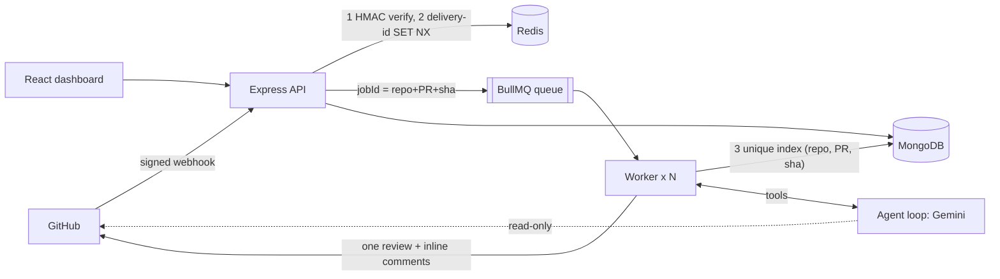

# AI Code Review Agent

A GitHub PR reviewer built as a **tool-using AI agent**. It receives signed `pull_request` webhooks, queues one job per commit, lets an LLM (**free Google Gemini by default**, or any OpenAI-compatible model) investigate the change with read-only tools (read files, search the repo, fetch diffs), then posts a single GitHub review with severity-ranked inline comments and one-click `suggestion` fixes. A React dashboard shows review history, quality metrics, and collects feedback on every finding.

**Stack:** Node/Express · MongoDB (Mongoose) · Redis + BullMQ · LLM function calling (Gemini / OpenAI-compatible) · GitHub API (Octokit) · React + Recharts · Docker

## Architecture



## What makes it agentic (not just "call the API")

| Piece | Behaviour |
|---|---|
| **Tool loop** | The model decides what to inspect: `get_file_content`, `get_file_diff`, `search_code`, `list_changed_files`. It verifies suspicions before reporting them. |
| **Terminal tool** | The run must end with `submit_review`, validated by a Zod schema (severity, category, confidence, line, optional suggestion). Invalid output is fed back for self-correction. |
| **Hard limits** | Max iterations, max tool calls, token budget. When any is hit, the agent is offered only the submit tool with `tool_choice: required` (supported by every provider), forcing a final submission, so every run is bounded in time and cost. |
| **Grounding** | Diffs are rendered with real new-file line numbers. Every finding is re-validated against the parsed diff, because GitHub rejects comments on lines outside it. Findings that fail validation move to the review summary instead of crashing the post. |
| **Noise control** | Confidence and severity thresholds, de-duplication, an inline-comment cap, ranked output. |
| **Prompt-injection defence** | PR content is wrapped as untrusted data; the agent has no write tools; model output is sanitised (no `@mentions`, images, or HTML comments that could spoof markers or exfiltrate data). |
| **Feedback loop** | Every finding can be rated helpful or not helpful in the dashboard, giving a measurable acceptance rate. |

## Reliability design

**Three idempotency layers** (the same event must never produce two reviews):
1. **Delivery ID**: Redis `SET NX EX` on `X-GitHub-Delivery`. The key is released if enqueueing fails, so GitHub's redelivery is not wrongly dropped.
2. **Job ID**: deterministic `repo_prN_sha`; BullMQ ignores duplicate adds.
3. **Database**: unique index on `(repoFullName, prNumber, headSha)`; the worker skips terminal states and handles the upsert race (`E11000`).

Plus: a marker-based check before posting (a retry after a successful post can't double-post), stale-commit detection before and after the model run, error classification (bad credentials or missing repo are not retried; rate limits and network errors back off exponentially), a rate-limited worker, and graceful shutdown that drains in-flight jobs.

**Security:** HMAC-SHA256 over the raw body with constant-time comparison, webhook route mounted before any JSON parser, Helmet, rate limiting, optional bearer key for the dashboard API, Zod validation on every input, regex-escaped search, Docker runs as non-root.

## Using free Google Gemini (default)

The app talks to Gemini through its OpenAI-compatible endpoint, so no extra SDK is needed.

1. Create a key (no card needed) at **https://aistudio.google.com/apikey**, then **Create API key**.
2. In `.env` set `LLM_API_KEY=<your key>`. Leave `LLM_PROVIDER=gemini` and `LLM_MODEL` empty to use the default model, or paste a current Flash / Flash-Lite model name from AI Studio.
3. Start with `DRY_RUN=true`, open a test PR, and read the result in the dashboard.

Good to know:
- **Free-tier limits are low and can change.** The app limits itself to `LLM_MAX_RPM=8` requests per minute and runs one job at a time. If you see `429` or "quota" errors, wait, lower `LLM_MAX_RPM`, or use a `flash-lite` model.
- **Privacy:** on the free tier Google may use prompts and responses to improve its products. Review only public or non-confidential code. For private code use a paid key, OpenAI, or a local Ollama model.
- **Switching providers is a config change**, not a code change: `LLM_PROVIDER=openai`, or `custom` with `LLM_BASE_URL` and `LLM_MODEL` for Groq, OpenRouter or Ollama (examples are at the bottom of `.env.example`).
- Compatibility details handled in code: Gemini 3 "thought signatures" are echoed back unchanged, empty tool-call ids are repaired, tool schemas avoid fields Gemini rejects, and `reasoning_effort` is sent only when configured.

## Quick start

```bash
cp .env.example .env            # fill GITHUB_WEBHOOK_SECRET, LLM_API_KEY (free Gemini key) and GitHub credentials
docker compose up --build       # api + worker + mongo + redis  ->  http://localhost:4000
```

Local development (needs Mongo and Redis running):
```bash
cd server && npm install && npm run dev        # API on :4000
cd server && npm run dev:worker                # worker
cd client && npm install && npm run dev        # dashboard on :5173 (proxies /api)
```

### Connect GitHub
1. Create a **GitHub App** (or use a PAT): permissions *Pull requests: read & write*, *Contents: read*, *Metadata: read*; subscribe to **Pull request** events.
2. Webhook URL `https://<your-host>/webhook`, content type `application/json`, secret = `GITHUB_WEBHOOK_SECRET`.
3. Install the app on a repo. For local testing, expose port 4000 with `npx smee-client` or ngrok.
4. Start with `DRY_RUN=true` to inspect results in the dashboard without posting.

## Tests
```bash
cd server && npm test            # 60 unit/integration tests, no external services needed
cd server && npm run e2e         # 23 end-to-end checks + GitHub App auth check (needs Redis + MongoDB running)
cd server && npm run e2e:ui      # 10 dashboard checks in jsdom against the real API + MongoDB
```
- **Unit/integration:** HMAC verification, webhook routing and dedupe, diff parsing and line validation, sanitisation, the agent loop (tool use, self-correction, iteration and token limits, forced submission), post-processing, the job pipeline against fakes, queue behaviour, config, auth, and the real app wiring.
- **End-to-end:** boots the real API and worker as separate processes on real Redis and MongoDB, with local stand-ins for GitHub and the model API (which mimics Gemini's quirks: strict tool schemas, thought signatures, empty tool-call ids). Covers signed webhooks, all three idempotency layers, 8 concurrent duplicate deliveries, retry with backoff after a transient 500, fatal 401 with no retry storm and later recovery, the 422 summary-only fallback, stale-commit handling, every API endpoint and MongoDB aggregation, and graceful SIGTERM shutdown.
- **Not covered:** real GitHub and Gemini traffic (use `DRY_RUN=true` for a first live trial) and real-browser rendering.

## Layout
```
server/src/  config · app · index · worker
  routes/      webhook (raw body + HMAC) · api (stats via $facet, reviews, feedback)
  agent/       agent loop · tools · prompts · schema · postprocess · format
  services/    queue · idempotency · github · processor (job pipeline)
  models/      Review (unique index = idempotency layer 3)
client/src/    App · components/Overview · components/ReviewDetail
```

## Known limits and next steps
- Evaluate quality: keep a labelled set of PRs and track precision and false-positive rate per prompt or model change; the feedback data is the starting point.
- Code search uses GitHub's search API (default branch index, rate limited). Embedding the repo into a vector store (e.g. Atlas Vector Search) would give richer repo-aware context.
- Natural extensions: specialist sub-agents (security/performance), reply-to-comment chat via `issue_comment` events, per-repo config file (`.aireview.yml`).

## Resume bullets
- Built an **agentic PR reviewer** (LLM function calling on free Google Gemini, provider-swappable) that investigates diffs with read-only tools (file reads, code search) and posts severity-ranked inline comments with one-click suggested fixes via the GitHub API.
- Designed a **reliable async pipeline** on Redis/BullMQ: HMAC-SHA256-verified webhooks, three-layer idempotency (delivery ID, deterministic job ID, unique DB index), stale-commit detection, retry/backoff with error classification.
- Bounded cost and latency with iteration, tool-call and token budgets, and hardened against **prompt injection** (untrusted-content framing, read-only tools, output sanitisation).
- Shipped a React/Recharts dashboard on MongoDB aggregation pipelines (`$facet`) with a finding-level feedback loop; covered by unit, end-to-end (real Redis/MongoDB) and UI test suites with CI.
